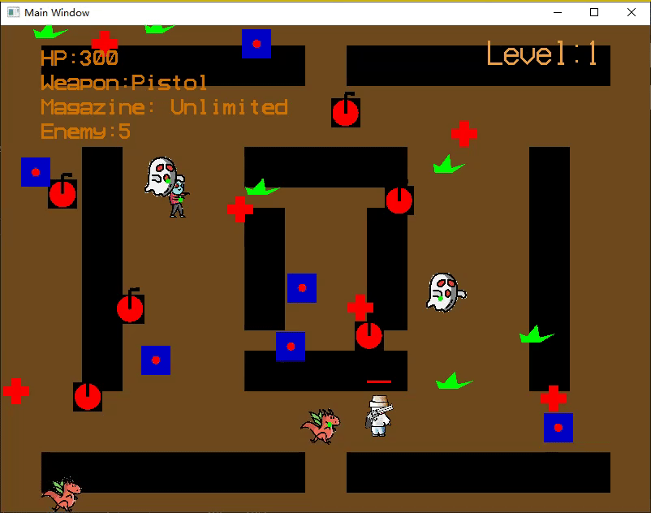

# Zombies-Infection

**A 2D top-down zombie shooter in C++ and OpenGL**
Team project, Carnegie Mellon University · Fall 2021



Survive waves of zombies on a walled map. Zombies hunt you down with path planning and shoot back; pick up weapon boxes, health packs and bombs to stay alive. Each cleared wave brings five more zombies.

## Controls

| Input | Action |
| --- | --- |
| `W` `A` `S` `D` | Move |
| Mouse | Aim — the gun rotates to follow the cursor |
| Left click | Shoot |
| `Q` / `E` | Previous / next weapon |
| `Esc` | Quit |

## Gameplay

- **Weapons** — Pistol (unlimited ammo, 1 damage), Rifle (40 rounds, 5 damage), Machine gun (100 rounds, 2 damage). Picking up a weapon you already own refills it; an empty weapon is dropped automatically.
- **Pickups** — six of each are scattered at random free cells every wave: health packs, bombs (hurt the player and any zombie inside the blast), grass, and weapon boxes with a random gun.
- **Zombies** — four types with their own sprites. Every 10 frames a living zombie fires at the player.
- **HUD** — HP, current weapon, magazine, zombies left and level.

## How it works

The game is organized as a set of classes driven by a single fixed-step loop in [`logicMain.cpp`](source/logicMain.cpp) (~40 fps, `FsSleep(25)`):

```
poll input → move everything → resolve collisions → draw → swap buffers
```

| Class | File | Responsibility |
| --- | --- | --- |
| `Player` | [`Player.h`](source/Player.h) / [`Player.cpp`](source/Player.cpp) | Movement, 4-direction sprites, weapon list, firing, HP |
| `Weapon` | [`Weapon.h`](source/Weapon.h) | Per-gun stats and the rotating gun sprite |
| `Bullet` | [`Bullet.h`](source/Bullet.h) | Straight-line projectile with an attack value |
| `Enemy` | [`Enemy.h`](source/Enemy.h) | Zombie state machine (alive / attacking / hit / dead), planning, shooting |
| `AStar` | [`AStar.h`](source/AStar.h) | Grid path planner used by every zombie |
| `Resource` → `Hprecover`, `Bomb`, `Green`, `Box` | [`resource.h`](source/resource.h) / [`resource.cpp`](source/resource.cpp) | Pickups behind one abstract interface (`init`, `Draw`, `Action`) |

**Map.** The 800×600 world is an occupancy grid (`double map[w*h]`, 1 = wall). Ten rectangular walls are rasterized into it; the player, zombies and pickups are only spawned on free cells, and movement and bullets are checked against the same grid.

**Zombie path planning.** Each frame a zombie first tries a cheap heuristic: step straight toward the player, and if that cell is blocked try ±60°. Only if all three are blocked does it run **weighted A\*** on the grid — 8-connected moves, Manhattan heuristic with weight *w* = 10 for speed, a priority queue for the open list and hash sets for open/closed — and take the first step of the path. On 30% of frames each velocity component is randomly dropped, which makes the horde look less robotic.

**Collisions.** Axis-aligned box checks between player ↔ pickups, bullets ↔ zombies, zombie bullets ↔ player, and bullets ↔ walls / screen edge. Bullets and pickups live in `std::list`s and are erased in place while iterating.

**Rendering.** Immediate-mode OpenGL. PNG sprites are decoded with YsPNG and drawn as textured quads with alpha blending; the gun is rotated toward the mouse with `glRotatef`. The three gun images are **decoded once at startup** and every `Weapon` holds a pointer to that shared array, so switching weapons never re-reads or re-decodes a PNG.

**Sound.** Looping background music through YsSimpleSound (DirectSound on Windows).

## Build and run (Windows)

The window, font, PNG and sound helpers (`fssimplewindow`, `ysglfontdata`, `yspng`, `yssimplesound`) are the Windows versions of the course framework, so the game builds on Windows with Visual Studio.

1. Create an empty C++ console project and add every `.cpp` and `.c` file in [`source/`](source/).
2. Build. The needed system libraries (`opengl32`, `glu32`, `dsound`, `winmm`, …) are linked through `#pragma comment` in the framework files.
3. Run with the **working directory set to `source/`** — sprites and `background.wav` are loaded by relative path.

## Team

Built with [Yifan Sun](https://github.com/YIFANSUN98) and [Joe Wang](https://github.com/Frederic-Wang).
